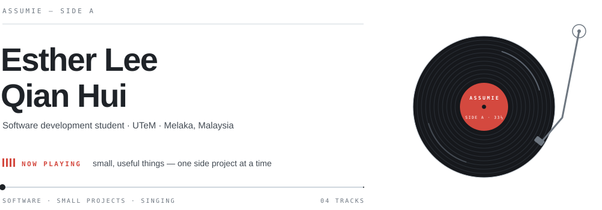
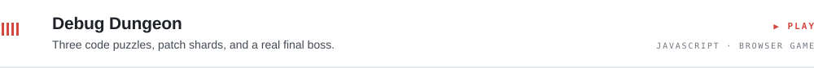
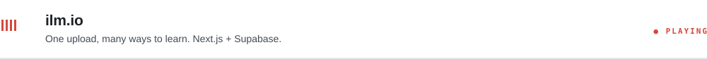
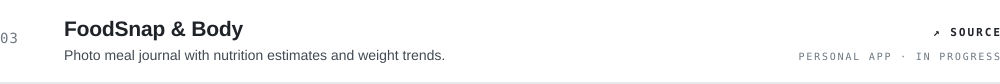
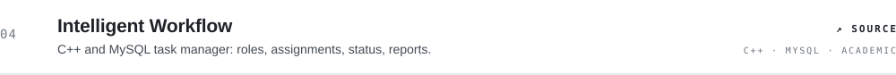
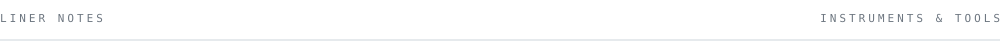
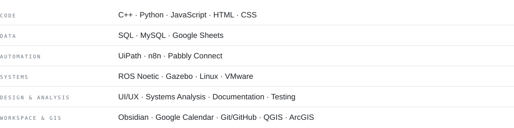

<picture>
  <source media="(prefers-color-scheme: dark)" srcset="assets/album/hero-dark.svg">
  
</picture>

Hi, I’m Esther. I study software development at UTeM and enjoy making useful things, trying out ideas, and learning as I go. 
我喜欢把日常的小问题变成简单、实用，也有一点自己风格的作品。

<picture>
  <source media="(prefers-color-scheme: dark)" srcset="assets/album/head-tracklist-dark.svg">
  
</picture>
<a href="https://assumie.github.io/debug-dungeon/">
<picture>
  <source media="(prefers-color-scheme: dark)" srcset="assets/album/track-01-dark.svg">
  
</picture>
</a>
<a href="https://assumie.github.io/clutch-lab/">
<picture>
  <source media="(prefers-color-scheme: dark)" srcset="assets/album/track-02-dark.svg">
  
</picture>
</a>
<a href="https://github.com/assumie/foodsnap-body">
<picture>
  <source media="(prefers-color-scheme: dark)" srcset="assets/album/track-03-dark.svg">
  
</picture>
</a>
<a href="https://github.com/assumie/iwms-cpp-mysql">
<picture>
  <source media="(prefers-color-scheme: dark)" srcset="assets/album/track-04-dark.svg">
  
</picture>
</a>

 

<picture>
  <source media="(prefers-color-scheme: dark)" srcset="assets/album/head-liner-dark.svg">
  
</picture>
<picture>
  <source media="(prefers-color-scheme: dark)" srcset="assets/album/liner-dark.svg">
  
</picture>

 

<picture>
  <source media="(prefers-color-scheme: dark)" srcset="assets/album/outro-dark.svg">
  
</picture>

LinkedIn · DEV.to · Portfolio · Medium · X

